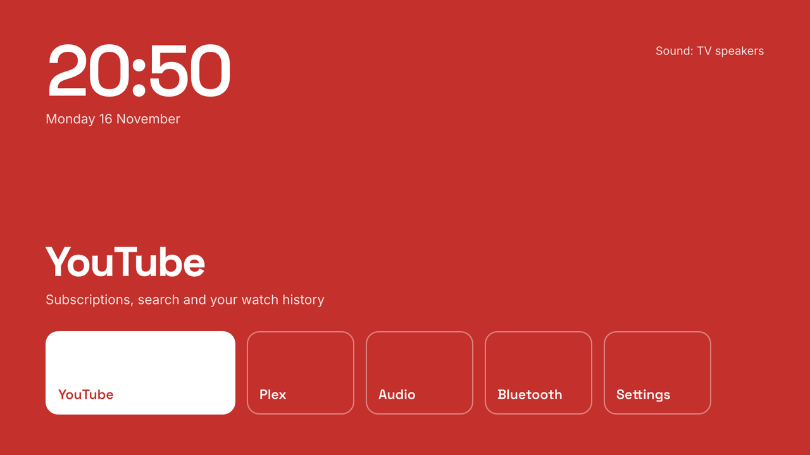
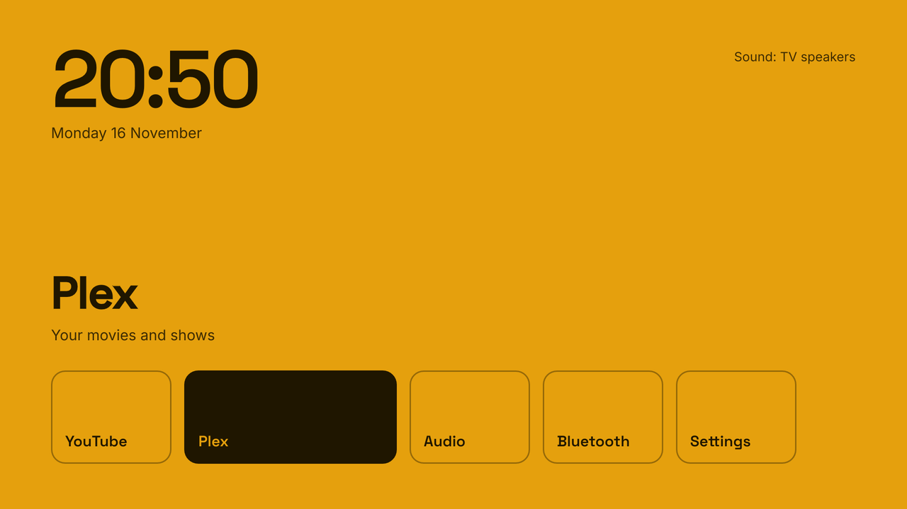
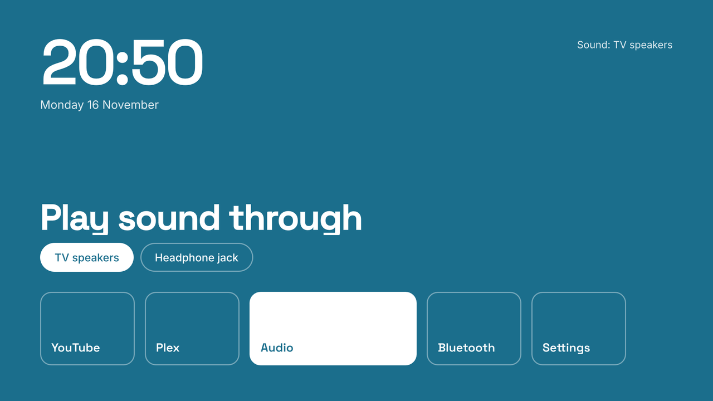
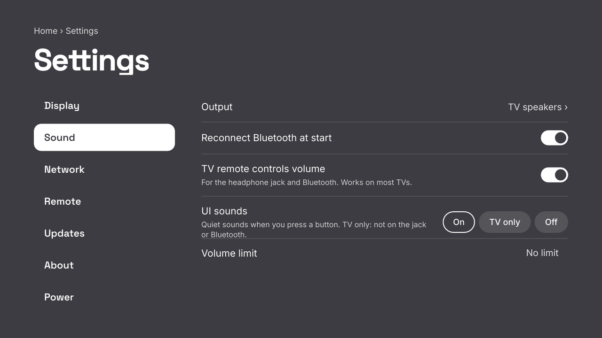
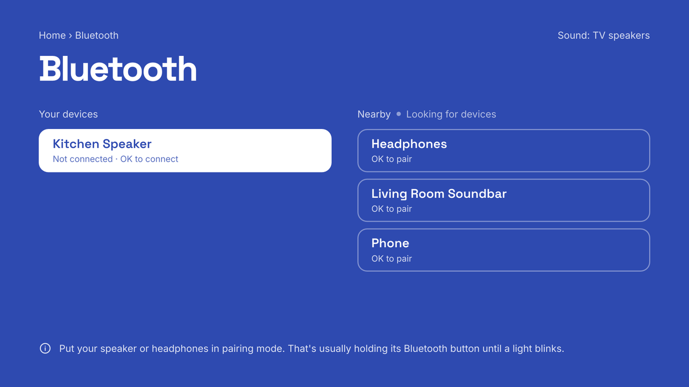
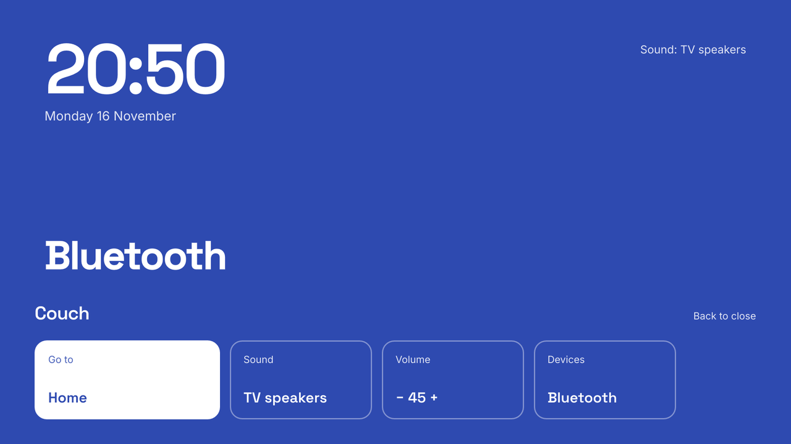
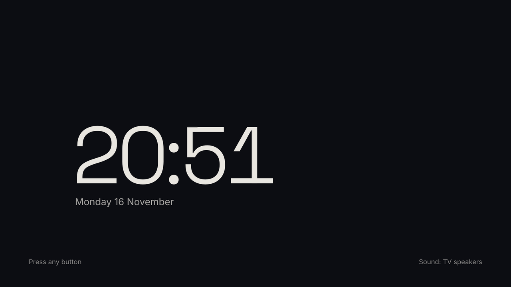
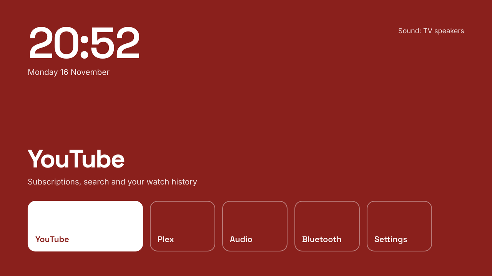
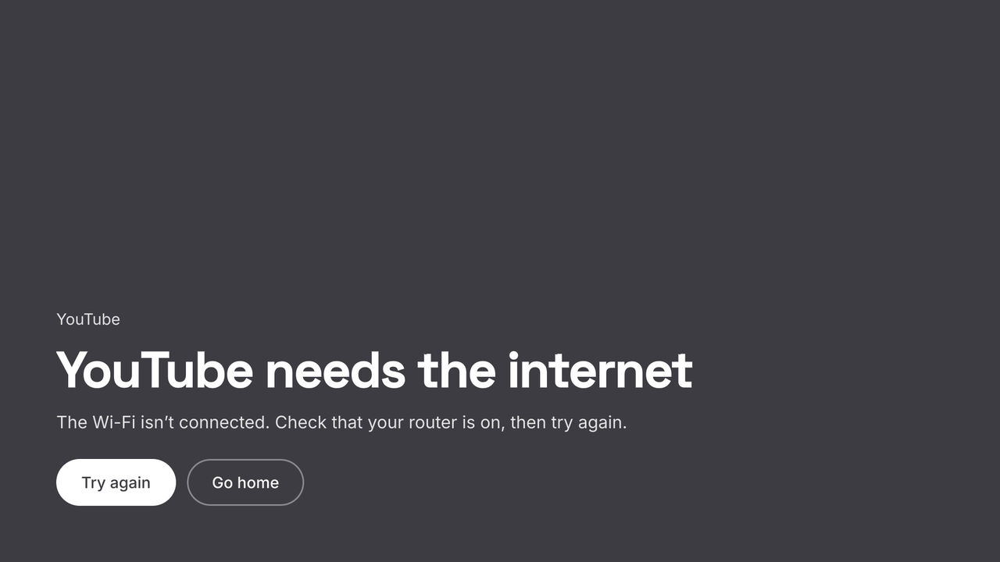
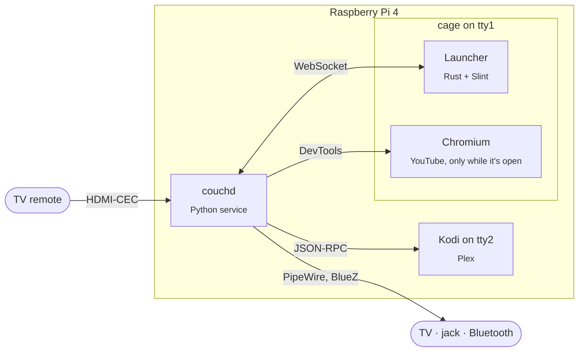

<h1 align="center">
  <picture>
    <source media="(prefers-color-scheme: dark)" srcset="ui/brand/svg/lockup-white.svg">
    
  </picture>
</h1>

<p align="center">
  <b>A TV launcher for the Raspberry Pi 4, driven entirely by the TV's own remote.</b><br>
  YouTube and Plex, sound wherever you want it, and nothing on screen that isn't for the couch.
</p>

<p align="center">
  
</p>

## What it does

- **One remote.** The TV's remote reaches the Pi over HDMI-CEC: arrows, OK, Back, the colour keys and volume all work, in the launcher, in YouTube and in Plex. Hold Back to go home from anywhere, press Blue for the quick menu ([the user guide](docs/user-guide.md) has every key).
- **YouTube** is YouTube's own TV interface, with hardware video decoding and your account. Back on its home screen takes you home.
- **Plex** opens straight into your Plex library (Plex for Kodi, with Kodi hidden), and leaving it lands you back on Home.
- **A speaker for your phone:** Couch shows up as "Couch" in Spotify (Spotify Connect, with Premium) and in the AirPlay menu of iPhones and Macs. Music wakes the TV and plays through whatever output Couch's sound is on.
- **Sound where you want it:** TV speakers, the headphone jack or a Bluetooth speaker, switched from Home or with the Red key, and the TV remote's volume keys follow it.
- **It looks after itself:** the TV turns on with the Pi and off when it's idle, a silent boot with an animation instead of text, overnight updates when nobody's watching, and it survives power cuts.

## A look around

Each card floods the screen with its own colour.

| | |
|:---:|:---:|
|  |  |
| **Plex**, a card away | **Audio**: pick where the sound goes, right on Home |
|  |  |
| **Settings**: sound, display, network, the remote, updates | **Bluetooth**: pair and connect speakers and headphones |
|  |  |
| **Quick menu** on Blue, over any app, YouTube and Plex included | **Opening** an app, in its colour, until it's ready |
|  |  |
| **Idle**: dims to a clock after a few minutes | **Evening colours**: deeper tones after sunset |

It says so when something's wrong, and what to do about it:

<p align="center">
  
</p>

And the boot goes from black to the Couch logo to Home, with no text or rainbow squares on the way:

<p align="center">
  
</p>

## How it fits together



- **couchd** (`couchd/`) is the brain, a Python asyncio service. It owns HDMI-CEC (`/dev/cec0`) and turns the remote's buttons into key presses, routes the sound through PipeWire, runs Bluetooth through BlueZ, and decides what's on screen. Everything goes through its API on `127.0.0.1:8765` ([docs/protocol.md](docs/protocol.md)).
- **The launcher** (`launcher/`) is a native app written in Rust with [Slint](https://slint.dev), full screen in the [cage](https://github.com/cage-kiosk/cage) kiosk compositor. It draws what couchd's state says and sends back what you pressed. It's on screen about a second after cage starts.
- **YouTube** is `youtube.com/tv` in Chromium, started in the same cage when you open it and stopped when you leave, so nothing runs behind Home.
- **Plex** is Plex for Kodi, with a skin that hides Kodi entirely. Kodi gets the screen to itself on its own console, and the launcher is right there when it exits.
- **The boot** (`system/`, `cage/`) keeps the Couch logo on screen from the kernel to Home: the kernel's own logo, an animation on the framebuffer, a patched cage that draws the logo from its first frame, and a small splash window until the launcher covers it. [system/README.md](system/README.md#boot) tells the whole story.

## In the repo

| Path | What lives there |
| --- | --- |
| [`couchd/`](couchd) | The service: CEC, sound, Bluetooth, apps, overlays, updates |
| [`launcher/`](launcher) | The launcher: Home, Settings, Bluetooth, the system screens (Rust, Slint) |
| [`ui/`](ui) | The brand (logo, splash, boot animation) and the overlays couchd draws over YouTube |
| [`system/`](system) | systemd units, the session, Chromium and Kodi setup, boot files |
| [`cage/`](cage) | The patch to cage that draws the boot logo from its first frame |
| [`docs/`](docs) | User guide, API, SD card, TV notes, performance, test checklist |
| [`tests/`](tests) | pytest suite (the launcher's tests are in `launcher/`) |
| [`scripts/`](scripts) | `dev.sh`, `deploy.sh`, `flash-sd.sh`, perf tools |
| [`install.sh`](install.sh) | Installs or updates Couch on Raspberry Pi OS Lite |

## Run it on your PC

Needs [uv](https://docs.astral.sh/uv/) and [Rust](https://rustup.rs).

```bash
scripts/dev.sh
```

That runs couchd with pretend hardware (a TV that takes a moment to wake up, the TV speakers and headphone jack, Bluetooth devices that appear when you search) and opens the launcher in a 1920×1080 window. Your keyboard is the remote:

| Key | Remote |
| --- | --- |
| Arrows | Arrows |
| Enter | OK |
| Backspace / Esc | Back |
| H / Home | Home |
| Space | Play/pause |
| F1 – F4 | Red, green, yellow, blue (Blue opens the quick menu) |

The fakes are slow the way real hardware is, and "Old Speaker" always refuses to pair, so the error screens show up too. `scripts/overlay-demo.sh` walks through the overlays, and anything else is a `curl` away:

```bash
curl -XPOST localhost:8765/api/command/apps.dev.network -d '{"internet": false}'
```

Tests and lint:

```bash
uv run pytest
uv run ruff check && uv run ruff format --check
cd launcher && cargo test && cargo clippy && cargo fmt --check
```

## Put it on a Pi

You need a Raspberry Pi 4 on [Raspberry Pi OS Lite](docs/sd-card.md) (64-bit, trixie), plugged into the TV's HDMI and the network, and SSH to it. The Pi doesn't build anything: the launcher and Couch's cage are cross-built on your PC in Docker, so you also need Docker and Rust's aarch64 target (`rustup target add aarch64-unknown-linux-gnu`). Then:

```bash
scripts/deploy.sh couch.local
```

It builds both, copies this checkout to `~/couch` on the Pi (keeping the last one as `~/couch.prev`) and runs `sudo ./install.sh` there. The install puts couchd in `/opt/couch`, adds a `couch` user, the apt packages, and two services, `couchd` and `couch-session`. Home is on the TV straight away, and after every boot.

To update, run it again: install.sh only changes what's different and restarts only what it changed. Logs: `journalctl -u couchd -u couch-session`. `sudo ./install.sh --uninstall` removes Couch but keeps `/etc/couch` and `/var/lib/couch`; `--purge` removes those and the user too.

The first install also sets up the silent boot by editing `cmdline.txt` and `config.txt` (`--uninstall` undoes exactly that), so reboot once afterwards.

### The TV

Couch draws to the very edge, so turn off the TV's overscan. On a Sony Bravia, with the Pi's input showing: Screen › Display Area › **Full Pixel**. And check that the TV's HDMI-CEC is on (Sony calls it BRAVIA Sync).

### YouTube

Open YouTube from Home and choose **Sign in with your phone**, then enter the code at [yt.be/activate](https://yt.be/activate). Chromium keeps the sign-in in `/var/lib/couch/chromium`, so it's once. **Watch as guest** works without an account.

### Configuration

Mostly there's nothing to configure: the settings live in the launcher. couchd also reads `/etc/couch/config.toml` if it's there ([every key, with its default](system/config.example.toml)); check one with `couchd --check-config`. A broken file is logged and ignored, so the TV still comes up.

## Status

An evening project, and young. It runs every day on one Pi 4 and one Sony TV ([what that TV's CEC really does](docs/tv-sony-kdl40v55.md)); other TVs will have their own CEC quirks. Not done yet:

- **Releases.** Overnight updates install GitHub releases, and there are none yet; when there are, they'll need the launcher and cage binaries attached. Until then, `scripts/deploy.sh`.
- **Performance numbers** for the native launcher ([docs/performance.md](docs/performance.md) still has the old web launcher's).

Work is tracked in [issues](https://github.com/alecschoen/couch/issues). Issues labelled `needs-pi` can only be finished on the real Pi and TV.

## License

[MIT](LICENSE). The fonts, Inter and Space Grotesk, are under the SIL Open Font License ([`launcher/fonts`](launcher/fonts)). YouTube and Plex are their owners' trademarks; Couch isn't affiliated with either.
